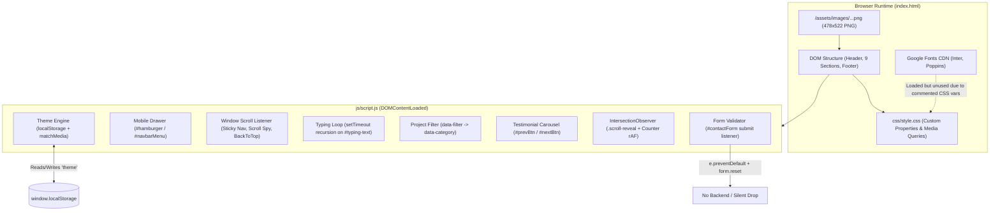
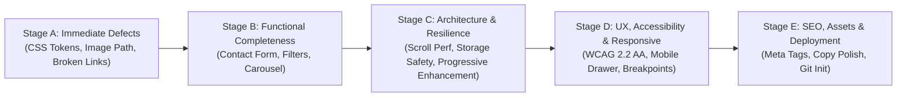
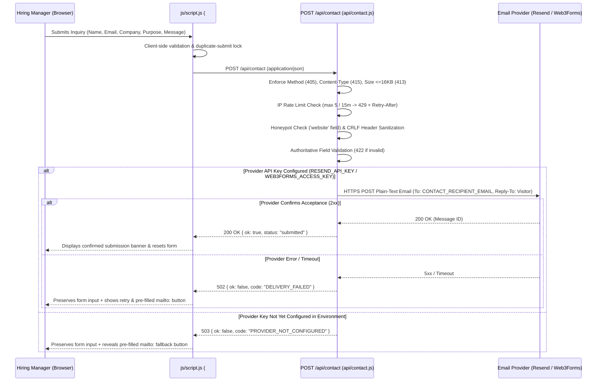
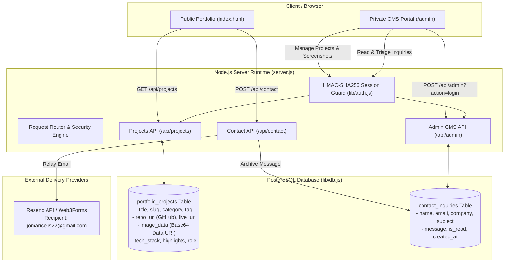

# Engineering-Level Portfolio System Audit and Implementation Assessment

**Repository Root:** `c:/Portfolio`  
**Audit Date:** October 26, 2026  
**Target System:** Personal Engineering & UI/UX Portfolio (Celis Jomarie)  
**Assessment Methodology:** Static Source-Code Inspection & Architectural Traceability (Zero-Modification Audit)

---

## 1. Executive Summary

The audited system is a client-side, single-page static portfolio website built with vanilla HTML5, CSS3, and ES6+ JavaScript. While the visual design system aims for a clean, minimalist aesthetic inspired by Linear and Vercel (featuring a custom light/dark theme engine, scroll-reveal animations, and a modular BEM-like CSS structure), **the implementation currently contains critical functional gaps, broken interactive controls, CSS variable regressions, and simulated workflows that prevent it from being production-ready.**

### Most Significant Risks & Findings
1. **Nonfunctional Contact Form (Simulated Submission):** The contact form (`#contactForm`) validates inputs client-side and displays a success message ("Transmission completed successfully"), but **performs no network request, API call, or email dispatch** (`js/script.js` lines 223–260). Visitors believing they have contacted the owner will have their messages silently discarded upon `form.reset()`.
2. **Every External & Project Link is a Dead Placeholder (`href="#"`):** All 9 external/action anchors across Projects (`View`, `Source Code`), Certifications (`Verify Credentials`), and Contact Socials (`GH`, `FB`, `TW`) point to `href="#"`. Clicking any of them scrolls the page back to the top and mutates the URL hash without navigating anywhere (`index.html` lines 197–198, 216–217, 260, 267, 309–311).
3. **Broken Design System Typography & Theme Tokens:**
   - The core font custom properties (`--font-heading` and `--font-body`) are commented out in `:root` (`css/style.css` lines 5–6), causing all references to `font-family: var(--font-body)` and `var(--font-heading)` to evaluate to invalid/empty declarations and fall back to browser defaults instead of the loaded Google Fonts (`Inter` and `Poppins`), while `.section-title` and `.skills__category` reference `"Manrope"`, which is never loaded (`css/style.css` lines 92, 434).
   - `.navbar--scrolled` uses `background-color: rgba(var(--clr-bg), 0.75)` (`css/style.css` line 166), which is invalid CSS because `--clr-bg` is a hex color (`#ffffff` / `#09090b`), rendering the sticky navbar background completely transparent instead of translucent.
   - `.navbar__link:hover, .navbar__link.active-link` references `var(--clr-text-main2)` (`css/style.css` line 210), which is only defined in `[data-theme="dark"]` (`line 36`) and completely undefined in light mode.
4. **Incomplete / Half-Commented Features Affecting UI Controls:**
   - **Project Filter Inconsistency:** The "Education" filter button (`data-filter="edu"`) is commented out (`index.html` line 179), while the "JavaLearn Offline Architect" project card (`data-category="edu"`, line 202) remains active. Selecting the "Health Tech" filter hides the Education project with no dedicated category filter to isolate it.
   - **Single-Item Testimonial Carousel:** The second `.carousel__item` is commented out (`index.html` lines 283–287), leaving only 1 slide (`items.length === 1`). Clicking `#prevBtn` or `#nextBtn` computes `(0 + 1) % 1 = 0` and translates `0%`, making the visible carousel buttons appear broken (`js/script.js` lines 167–177).
5. **Fragile Asset Pathing & Missing Version Control:** The hero profile image uses a root-relative path (`src="/assets/images/IMG_20230626_135533-removebg-preview.png"`, `index.html` line 63) with an empty `alt=""`, which breaks when opened via `file://` or deployed to a subdirectory (e.g., GitHub Pages `/<repo-name>/`). Additionally, the project directory is not initialized as a Git repository (`.git` is absent).

---

## 2. Technology and Architecture Inventory

### 2.1 Actual Stack & File Inventory
The entire repository consists of **4 files** across **4 directories** (total size ~230 KB). Every file in the workspace was inspected in full:

| File Path | Size (Bytes) | Role / Responsibility |
|---|---:|---|
| [index.html](file:///c:/Portfolio/index.html) | 22,959 | Single-page HTML5 document containing 9 content sections, navigation header, and footer. |
| [css/style.css](file:///c:/Portfolio/css/style.css) | 23,041 | Monolithic stylesheet (1,000 lines) defining CSS custom properties, dark mode overrides, layout grids, component styles, animations, and responsive media queries (`1024px`, `768px`). |
| [js/script.js](file:///c:/Portfolio/js/script.js) | 11,070 | Client-side behavioral script (261 lines) bound to `DOMContentLoaded` handling theme persistence, mobile drawer, scroll spy, typewriter text, project filtering, testimonial carousel, animated counters, `IntersectionObserver` reveals, and form validation. |
| [assets/images/IMG_20230626_135533-removebg-preview.png](file:///c:/Portfolio/assets/images/IMG_20230626_135533-removebg-preview.png) | 173,571 | 478×522 32-bit RGBA PNG portrait used in the Hero section. |

### 2.2 Application Classification & Architecture
- **Application Type:** Static Single-Page Website (Vanilla HTML/CSS/JS, zero build step, no frontend framework or router).
- **External Dependencies:** Google Fonts CDN (`Inter` weights 400, 500, 600; `Poppins` weights 500, 600, 700) loaded via `<link>` in [index.html](file:///c:/Portfolio/index.html#L8-L10).
- **Version Control / Tooling:** No `.git` repository, no `package.json`, no linter/formatter configuration, no build bundler, and no automated test suite.

### 2.3 System Architecture & Runtime Flow


---

## 3. Page and Feature Inventory

Because this is a single-page portfolio, all features reside within [index.html](file:///c:/Portfolio/index.html) and are driven by [css/style.css](file:///c:/Portfolio/css/style.css) and [js/script.js](file:///c:/Portfolio/js/script.js).

| Feature / Section | Location & Entry Point | Intended Purpose | Actual Implementation & Dependencies | Current Status | Identified Problems |
|---|---|---|---|---|---|
| **Global Navigation Bar** | [index.html](file:///c:/Portfolio/index.html#L17-L46), [style.css](file:///c:/Portfolio/css/style.css#L155-L263), [script.js](file:///c:/Portfolio/js/script.js#L30-L87) | Fixed top navigation with section anchor links, active section highlighting, and mobile off-canvas drawer. | Fixed `<header id="navbar">`, 8 `.navbar__link` anchors, scroll spy in `handleScroll()`, mobile drawer toggled via `#hamburger`. | **Partially Complete** | Sticky background `rgba(var(--clr-bg), 0.75)` is invalid CSS; light-mode active/hover color `var(--clr-text-main2)` is undefined; no `scroll-padding-top` for fixed header offset; mobile menu lacks focus trap, Escape key handler, and backdrop click dismissal. |
| **Theme Switcher (Light/Dark)** | [index.html](file:///c:/Portfolio/index.html#L35-L38), [style.css](file:///c:/Portfolio/css/style.css#L4-L40), [script.js](file:///c:/Portfolio/js/script.js#L6-L25) | Toggle between Light and Dark mode with system preference fallback and `localStorage` persistence. | Reads `localStorage.getItem('theme')` or `prefers-color-scheme: dark`; sets/removes `data-theme="dark"` on `<html>`. | **Partially Complete** | Theme initializes inside `DOMContentLoaded` (causing potential Flash of Unstyled/Wrong Theme Content); `localStorage` access is not wrapped in `try/catch`; Hero avatar circle has hardcoded `background-color: white` ([style.css](file:///c:/Portfolio/css/style.css#L327)) overriding `var(--clr-surface)` in dark mode. |
| **Back-to-Top Control** | [index.html](file:///c:/Portfolio/index.html#L15), [style.css](file:///c:/Portfolio/css/style.css#L922-L942), [script.js](file:///c:/Portfolio/js/script.js#L64-L68) | Floating button appearing after scrolling >600px to smoothly return to top. | `#backToTop` toggled `.visible` in `handleScroll()`, calls `window.scrollTo({ top: 0, behavior: 'smooth' })`. | **Complete** | Works as designed; placed as first focusable element in `<body>` before `<header>` instead of near footer or after skip link. |
| **Hero & Typewriter Intro** | [index.html](file:///c:/Portfolio/index.html#L49-L68), [style.css](file:///c:/Portfolio/css/style.css#L268-L346), [script.js](file:///c:/Portfolio/js/script.js#L95-L126) | Introduce Celis Jomarie with dynamic rotating titles, CTA buttons, and profile portrait. | `executeTypeSequence()` cycles 3 strings via `setTimeout`; two CTA links (`#projects`, `#contact`); profile image in `.hero__avatar-placeholder`. | **Partially Complete** | Root-relative image path `/assets/images/...` fails on `file://` or subpath deployments; empty `alt=""` on profile photo; when `#typing-text` hits 0 characters (`letterIdx === 0`), the `<br><span id="typing-text"></span>` line collapses height momentarily unless stabilized, and screen readers receive continuous DOM text mutations. |
| **About Me & Animated Counters** | [index.html](file:///c:/Portfolio/index.html#L70-L102), [style.css](file:///c:/Portfolio/css/style.css#L351-L407), [script.js](file:///c:/Portfolio/js/script.js#L182-L218) | Biography, B.S. IT education, personal motto, and animated counters (50+ Projects, 15+ Clients). | `IntersectionObserver` watches `.about__facts` and triggers `startCounterSequence()` via `requestAnimationFrame`. | **Complete** | Functional, though copy contains minor grammatical errors ("digital crafty experience", "My moto") and if JavaScript fails, counters remain stuck at `0+`. |
| **Technical Expertise (Skills)** | [index.html](file:///c:/Portfolio/index.html#L104-L147), [style.css](file:///c:/Portfolio/css/style.css#L412-L462) | Categorized progress bars for Frontend, Backend, and Data & Tools. | Static inline `style="width: XX%"` inside `.skills__progress`. | **Complete** | Progress bars Lack `role="progressbar"` / `aria-valuenow` semantics (though adjacent text spans show the percentage). Uses unloaded `"Manrope"` font and invalid `font-style: bold`. |
| **Services Offered** | [index.html](file:///c:/Portfolio/index.html#L149-L170), [style.css](file:///c:/Portfolio/css/style.css#L467-L497) | 3-column grid highlighting Web Development, UI/UX Interface Design, and Responsive Crafting. | Static HTML cards with emoji icons (`⚙️`, `📐`, `📱`). | **Complete** | Emoji icons lack `aria-hidden="true"`. |
| **Featured Projects & Ecosystem Filter** | [index.html](file:///c:/Portfolio/index.html#L172-L223), [style.css](file:///c:/Portfolio/css/style.css#L502-L604), [script.js](file:///c:/Portfolio/js/script.js#L131-L152) | Filterable project showcase with live demo and source code links. | 2 filter buttons (`all`, `health`; `edu` is commented out), 2 project cards (`health`, `edu`). Text placeholders instead of project screenshots. | **Broken / Incomplete** | 1) Both `View` and `Source Code` buttons on both cards are `href="#"` placeholders. 2) `edu` filter button is commented out while `edu` card exists. 3) Hiding animation sets `opacity = '0'` and `display = 'none'` synchronously on the same tick, preventing any fade-out transition. |
| **Academic Experience Timeline** | [index.html](file:///c:/Portfolio/index.html#L225-L249), [style.css](file:///c:/Portfolio/css/style.css#L609-L666) | Vertical chronological timeline of academic/project leadership roles. | 1 active `.timeline__item` (Capstone Project Leader) and 1 commented-out item. | **Complete** | Works visually; second commented-out item shares identical placeholder description text with the first item. |
| **Certifications** | [index.html](file:///c:/Portfolio/index.html#L251-L271), [style.css](file:///c:/Portfolio/css/style.css#L671-L716) | Display professional certificates with credential verification links. | 2 `.cert-card` items (NetAcads Cybersecurity & Machine Learning). | **Incomplete / Broken** | Both `Verify Credentials →` links use `href="#"` placeholders instead of real credential verification URLs. |
| **Peer Endorsements (Testimonial Carousel)** | [index.html](file:///c:/Portfolio/index.html#L273-L295), [style.css](file:///c:/Portfolio/css/style.css#L721-L780), [script.js](file:///c:/Portfolio/js/script.js#L157-L177) | Horizontal sliding carousel of peer testimonials with Previous/Next controls. | `#testimonialCarousel` translated via `translateX(-${index * 100}%)`. | **Broken / Incomplete** | Second testimonial slide is commented out (`index.html` lines 283–287), leaving only 1 slide. Clicking `←` or `→` produces `translateX(-0%)`, making the controls visibly nonfunctional. Section also lacks an `id` attribute (not linked in navbar, which is acceptable, but worth noting). |
| **Contact Information & Form** | [index.html](file:///c:/Portfolio/index.html#L297-L342), [style.css](file:///c:/Portfolio/css/style.css#L785-L886), [script.js](file:///c:/Portfolio/js/script.js#L223-L260) | Display location, email, social links, and a direct message transmission form. | Client-side validation on 4 fields; displays `#formSuccess` div on valid submit. | **Broken / Simulated** | 1) Form submission is purely simulated—no backend, `fetch`, or `mailto:` integration exists. 2) All 3 social links (`GH`, `FB`, `TW`) are `href="#"`, and the `FB` link has a mismatched `aria-label="LinkedIn Profile"`. 3) Email address `contact@celisEc.dev` is plain text rather than a `mailto:` link. |
| **Resume / CV Viewing & Download** | N/A | Allow recruiters/clients to view or download a PDF resume/CV. | Not present anywhere in HTML, CSS, JS, or `assets/`. | **Missing** | Entirely absent from the portfolio. |
| **Footer** | [index.html](file:///c:/Portfolio/index.html#L345-L354), [style.css](file:///c:/Portfolio/css/style.css#L891-L917) | Copyright notice and quick jump links (`#home`, `#about`, `#projects`). | Static `<footer>` with 3 internal anchor links. | **Complete** | Functional. |

---

## 4. Navigation, Routing, Links, and Interaction Audit

### 4.1 Complete Anchor and Interactive Control Audit Table

Every `<a>`, `<button>`, and `<form>` element in [index.html](file:///c:/Portfolio/index.html) was inspected and cross-referenced against [js/script.js](file:///c:/Portfolio/js/script.js):

| Element or Location | Current Implementation | Problem | Recommended Approach | Priority |
|---|---|---|---|---|
| **NutriCare Project "View" Link**<br>[index.html#L197](file:///c:/Portfolio/index.html#L197) | `<a href="#" class="btn btn--sm btn--primary">View</a>` | Placeholder `href="#"` scrolls window to top (`#`) instead of opening a live demo or project detail modal/page. | Replace with real deployment URL (`target="_blank" rel="noopener noreferrer"`) or, if no live deployment exists, open a project case-study modal (`<button type="button">`) or render a disabled state (`aria-disabled="true"`). | **High** |
| **NutriCare Project "Source Code" Link**<br>[index.html#L198](file:///c:/Portfolio/index.html#L198) | `<a href="#" class="btn btn--sm btn--secondary">Source Code</a>` | Placeholder `href="#"` scrolls to top of page. | Replace with actual GitHub repository URL (`https://github.com/...`) with `target="_blank" rel="noopener noreferrer"`. | **High** |
| **JavaLearn Project "View" Link**<br>[index.html#L216](file:///c:/Portfolio/index.html#L216) | `<a href="#" class="btn btn--sm btn--primary">View</a>` | Placeholder `href="#"` scrolls to top of page. | Replace with actual release/demo URL or case-study modal trigger button. | **High** |
| **JavaLearn Project "Source Code" Link**<br>[index.html#L217](file:///c:/Portfolio/index.html#L217) | `<a href="#" class="btn btn--sm btn--secondary">Source Code</a>` | Placeholder `href="#"` scrolls to top of page. | Replace with actual GitHub repository URL with `target="_blank" rel="noopener noreferrer"`. | **High** |
| **Cybersecurity Certificate Link**<br>[index.html#L260](file:///c:/Portfolio/index.html#L260) | `<a href="#" class="cert-card__link">Verify Credentials →</a>` | Placeholder `href="#"` scrolls to top of page; misleads users attempting to verify Cisco NetAcad/Credly badge. | Point to actual Credly/NetAcad verification URL or hosted certificate PDF with `target="_blank" rel="noopener noreferrer"`. | **High** |
| **Machine Learning Certificate Link**<br>[index.html#L267](file:///c:/Portfolio/index.html#L267) | `<a href="#" class="cert-card__link">Verify Credentials →</a>` | Placeholder `href="#"` scrolls to top of page. | Point to actual credential verification URL or hosted certificate asset. | **High** |
| **Contact GitHub Link**<br>[index.html#L309](file:///c:/Portfolio/index.html#L309) | `<a href="#" aria-label="GitHub Profile">GH</a>` | Placeholder `href="#"` scrolls to top of page. | Replace with actual GitHub profile URL with `target="_blank" rel="noopener noreferrer"`. | **High** |
| **Contact Facebook/LinkedIn Link**<br>[index.html#L310](file:///c:/Portfolio/index.html#L310) | `<a href="#" aria-label="LinkedIn Profile">FB</a>` | 1) Placeholder `href="#"` scrolls to top.<br>2) Visible label says `FB` (Facebook) while `aria-label` says `"LinkedIn Profile"`, creating a direct visual vs. assistive-tech contradiction. | Decide whether link is Facebook or LinkedIn, align visible text/icon with `aria-label`, and provide valid external URL with `target="_blank" rel="noopener noreferrer"`. | **High** |
| **Contact Twitter/X Link**<br>[index.html#L311](file:///c:/Portfolio/index.html#L311) | `<a href="#" aria-label="Twitter Profile">TW</a>` | Placeholder `href="#"` scrolls to top of page. | Provide valid profile URL or remove if unused. | **High** |
| **Navbar Section Links (8 links) & Footer/Hero Anchors**<br>[index.html#L19-L31](file:///c:/Portfolio/index.html#L19-L31), [#L56-L57](file:///c:/Portfolio/index.html#L56-L57), [#L349-L351](file:///c:/Portfolio/index.html#L349-L351) | `<a href="#home">`, `#about`, `#skills`, `#services`, `#projects`, `#experience`, `#certificates`, `#contact` | All 8 target `<section id="...">` elements exist and have unique IDs. However, `html` lacks `scroll-padding-top: 72px` (height of fixed `.navbar`), and `script.js:77` uses an unquoted attribute selector `.navbar__link[href*=${sectionId}]` with a hardcoded `- 100` offset. | Add `scroll-padding-top: 72px;` to `html` in `css/style.css` and quote the attribute selector `.navbar__link[href="#${sectionId}"]` in `js/script.js`. | **Medium** |
| **Contact Email Display**<br>[index.html#L306](file:///c:/Portfolio/index.html#L306) | `<li><strong>Secure Email:</strong> contact@celisEc.dev</li>` | Rendered as static text; users cannot click to open their mail client. | Wrap email in `<a href="mailto:contact@celisEc.dev">contact@celisEc.dev</a>`. | **Low** |
| **Button Elements (`#backToTop`, `#themeToggle`, `#hamburger`, `.filter-btn`, `#prevBtn`, `#nextBtn`)**<br>[index.html#L15](file:///c:/Portfolio/index.html#L15), [#L35](file:///c:/Portfolio/index.html#L35), [#L39](file:///c:/Portfolio/index.html#L39), [#L177-L178](file:///c:/Portfolio/index.html#L177-L178), [#L290-L291](file:///c:/Portfolio/index.html#L290-L291) | `<button class="...">` (without explicit `type` attribute) | While outside a `<form>`, `<button>` defaults to `type="submit"` per HTML spec. Explicit `type="button"` is best practice for non-submit buttons. | Add `type="button"` to all non-form action buttons. | **Low** |

---

## 5. Functional Verification Matrix

In accordance with Engineering Rule #5 (*No false verification*), the table below explicitly distinguishes findings verified via **Static Code Analysis (Deterministic Execution Trace)** from items that require **Interactive Browser Runtime Verification**.

| Interactive Feature | Expected Behavior | Actual Behavior (Code Trace) | Verification Method | Status |
|---|---|---|---|---|
| **Theme Toggle (`#themeToggle`)** | Toggles `data-theme="dark"` on `<html>`, swaps sun/moon SVG, and saves `'dark'`/`'light'` to `localStorage`. | Works in normal browser contexts. However, if `localStorage` is blocked (e.g., strict privacy mode), `localStorage.getItem`/`setItem` throws an uncaught `SecurityError` at line 7, halting all subsequent JS initialization in `script.js`. | Static Code Analysis ([script.js#L6-L25](file:///c:/Portfolio/js/script.js#L6-L25)) | **Partially Complete** (Fragile error handling) |
| **Mobile Menu (`#hamburger`)** | Opens/closes off-canvas `.navbar__menu` at `<=768px`, toggles `aria-expanded`, closes when a `.navbar__link` is clicked. | Opens/closes on button click and link click. Does **not** close on `Escape` key press, clicking outside the drawer (`80%` width), or resizing viewport past `768px`. | Static Code Analysis ([script.js#L30-L46](file:///c:/Portfolio/js/script.js#L30-L46), [style.css#L976-L998](file:///c:/Portfolio/css/style.css#L976-L998)) | **Partially Complete** |
| **Sticky Navbar & Scroll Spy** | Adds `.navbar--scrolled` after `scrollY > 20`; highlights active `.navbar__link` based on section offset. | Class `.navbar--scrolled` is applied, but `rgba(var(--clr-bg), 0.75)` is invalid CSS so background remains transparent. Active link class `.active-link` is toggled, but `color: var(--clr-text-main2)` is undefined in light mode. | Static Code Analysis ([style.css#L165-L211](file:///c:/Portfolio/css/style.css#L165-L211), [script.js#L55-L87](file:///c:/Portfolio/js/script.js#L55-L87)) | **Broken Styling in Light Mode** |
| **Hero Typewriter (`#typing-text`)** | Cycles through 3 role phrases with typing/deleting effect. | Recursive `setTimeout` updates `textContent`. When `letterIdx === 0`, `#typing-text` becomes empty `""`, which can collapse the second line of `h1.hero__title` for 400ms unless line height is preserved. | Static Code Analysis ([script.js#L95-L126](file:///c:/Portfolio/js/script.js#L95-L126)) | **Partially Complete** (Layout jitter risk) |
| **Animated Stats Counters** | Counts from `0` to `50` and `15` when `.about__facts` enters viewport. | `IntersectionObserver` triggers `startCounterSequence` once and unobserves. Uses `requestAnimationFrame` (~17–30 frames). | Static Code Analysis ([script.js#L182-L218](file:///c:/Portfolio/js/script.js#L182-L218)) | **Complete** |
| **Project Category Filtering** | Filters `.project-card` elements by `data-category` with smooth opacity transition. | 1) Only `all` and `health` buttons exist (`edu` button is commented out). Clicking `health` hides the `edu` card (`JavaLearn`); clicking `all` restores both.<br>2) Fade-out is broken because `card.style.opacity = '0'` and `card.style.display = 'none'` execute synchronously on lines 147–148. | Static Code Analysis ([index.html#L176-L220](file:///c:/Portfolio/index.html#L176-L220), [script.js#L131-L152](file:///c:/Portfolio/js/script.js#L131-L152)) | **Partially Broken** |
| **Testimonial Carousel (`#prevBtn`, `#nextBtn`)** | Cycles between multiple peer endorsements on click. | Only 1 `.carousel__item` is uncommented (`items.length === 1`). Clicking `#nextBtn` or `#prevBtn` calculates `0 % 1 = 0` and sets `transform: translateX(-0%)`. Visually does nothing. | Static Code Analysis ([index.html#L277-L292](file:///c:/Portfolio/index.html#L277-L292), [script.js#L157-L177](file:///c:/Portfolio/js/script.js#L157-L177)) | **Broken (No-Op)** |
| **Contact Form Validation & Submission** | Validates Name, Email, Subject, Message; submits payload; shows confirmation. | Validation works on submit (shows `.form__error`, turns border `#ef4444`). However, valid submission **only** reveals `#formSuccess` and resets the form—**no data is transmitted anywhere**. Also, typing into an errored field does not clear the error until the user clicks Submit again. | Static Code Analysis ([script.js#L223-L260](file:///c:/Portfolio/js/script.js#L223-L260)) | **Broken (Simulated Only)** |

---

## 6. Code Quality and Architecture Findings

### 6.1 Broken CSS Custom Properties & Invalid Declarations
1. **Commented-Out Root Typography Tokens ([css/style.css#L5-L6](file:///c:/Portfolio/css/style.css#L5-L6)):**
   ```css
   :root {
       /* --font-heading: 'Poppins', system-ui, -apple-system, sans-serif;
       --font-body: 'Inter', system-ui, -apple-system, sans-serif; */
   ```
   Because `--font-heading` and `--font-body` are commented out, all 7 rules referencing them (`body`, `h1..h4`, `.btn`, `.navbar__logo`, `.hero__avatar-placeholder`, `.counter-card__number`, `.filter-btn`, `.project-card__placeholder`, `.carousel__quote`, `.form__input`) resolve to `unset`, falling back to the user agent's default serif/sans-serif font despite downloading `Inter` and `Poppins` from Google Fonts.
2. **Unloaded Font Family & Invalid `font-style` ([css/style.css#L92-L93](file:///c:/Portfolio/css/style.css#L92-L93), [#L434-L435](file:///c:/Portfolio/css/style.css#L434-L435)):**
   `.section-title` and `.skills__category` specify `font-family: "Manrope", sans-serif;` (which is not imported in `index.html`) and `font-style: bold;` (`bold` is a `font-weight` value, not a valid `font-style` value; valid values are `normal`, `italic`, `oblique`).
3. **Invalid `rgba()` Syntax with Hex Custom Property ([css/style.css#L166](file:///c:/Portfolio/css/style.css#L166)):**
   ```css
   .navbar--scrolled {
       background-color: rgba(var(--clr-bg), 0.75);
   ```
   Since `--clr-bg` is `#ffffff` (light) or `#09090b` (dark), `rgba(#ffffff, 0.75)` is invalid CSS syntax and is dropped by the browser parser. Modern CSS requires either `color-mix(in srgb, var(--clr-bg) 75%, transparent)` or defining RGB channel tokens (`--clr-bg-rgb: 255, 255, 255`).
4. **Asymmetric Theme Variable `--clr-text-main2` ([css/style.css#L36](file:///c:/Portfolio/css/style.css#L36), [#L210](file:///c:/Portfolio/css/style.css#L210)):**
   `--clr-text-main2: #3b82f6;` is declared inside `[data-theme="dark"]` but omitted from `:root`. Consequently, `.navbar__link:hover, .navbar__link.active-link { color: var(--clr-text-main2); }` fails to apply an accent color in Light Mode.
5. **Hardcoded Override in `.hero__avatar-placeholder` ([css/style.css#L326-L327](file:///c:/Portfolio/css/style.css#L326-L327)):**
   ```css
   background-color: var(--clr-surface);
   background-color: white;
   ```
   Line 327 immediately overrides `var(--clr-surface)` with a hardcoded `white`, causing a stark white circle behind the transparent portrait even in dark mode.
6. **Unused CSS Token:** `--clr-hover-bg` is defined in both `:root` (line 18) and `[data-theme="dark"]` (line 39) but is never referenced anywhere in `style.css`.

### 6.2 JavaScript Architecture & Runtime Fragility
1. **Unthrottled Scroll Handler with Repeated DOM Queries ([js/script.js#L55-L89](file:///c:/Portfolio/js/script.js#L55-L89)):**
   `handleScroll` runs on every `scroll` event without `{ passive: true }` or `requestAnimationFrame` throttling, reading layout geometry (`offsetHeight`, `offsetTop`) and executing `document.querySelector(\`.navbar__link[href*=${sectionId}]\`)` for all 8 sections on every single scroll tick.
2. **Synchronous `display: none` Cancels Filter Transition ([js/script.js#L141-L150](file:///c:/Portfolio/js/script.js#L141-L150)):**
   In the project filter click handler, hiding a card sets `card.style.opacity = '0'` and immediately sets `card.style.display = 'none'` on the next line, removing the element from layout before any CSS transition can occur.
3. **Inline Style Mutation on Form Validation ([js/script.js#L243-L247](file:///c:/Portfolio/js/script.js#L243-L247)):**
   Validation sets `inputElement.style.borderColor = '#ef4444'` directly via inline styles, which overrides CSS `:focus` rules (`border-color: var(--clr-text-main)`). Furthermore, after a valid submission calls `form.reset()`, if the user had not triggered validation again, inline `borderColor` styles persist instead of using a semantic CSS class (e.g., `.form__input--error`).

---

## 7. UI/UX and Responsive Design Audit

### 7.1 Layout & Viewport Behavior Analysis
- **Desktop (`1440px` / `1200px` container):** Balanced grid proportions (`1.2fr 0.8fr` hero, `3-column` skills/services, `2-column` projects/certificates).
- **Tablet (`<= 1024px`, [css/style.css#L959-L963](file:///c:/Portfolio/css/style.css#L959-L963)):**
  - **Defect (UX-001):** The mobile hamburger menu only activates at `@media (max-width: 768px)` (line 976). Between `769px` and `1024px`, `.navbar__list` remains a horizontal flex row with `gap: 32px` containing 8 links (`Home`, `About Me`, `Skills`, `Services`, `Projects`, `Experience`, `Certificates`, `Contact`) plus the logo and action buttons. At `769px–960px`, this horizontal list overflows or crowds the `72px` header container.
- **Mobile (`<= 768px` & `320px–375px`, [css/style.css#L965-L1000](file:///c:/Portfolio/css/style.css#L965-L1000)):**
  - **Defect (UX-002):** `.hero__title` is `54px` on desktop, reduced to `44px` at `<=1024px`, and **never reduced further** at `<=768px` or `<=375px`. At `320px–375px` viewports, a `44px` heading (`"Hello, I'm Celis Jomarie"` + `"UI/UX System Designer."`) causes awkward multi-line wrapping and vertical layout shifts as the typewriter text expands/contracts from 1 line to 2 lines.
  - **Defect (UX-003):** `.about__counters` (`display: flex; gap: 32px;`, line 388) and `.hero__actions` (`display: flex; gap: 16px;`, line 311) lack `flex-wrap: wrap`, risking horizontal cramping on narrow `320px` screens.
  - **Defect (UX-004):** Fixed navbar (`height: 72px`) overlaps the top of sections when navigating via anchor links (`#about`, `#projects`, etc.) because `html` has no `scroll-padding-top`.

---

## 8. Accessibility Audit (WCAG 2.2 Level AA)

| WCAG Criterion | Finding | Location | Impact |
|---|---|---|---|
| **1.1.1 Non-text Content (Level A)** | Profile image has an empty `alt=""` attribute (``), marking the primary subject portrait as decorative. Meanwhile, decorative emojis (`⚙️`, `📐`, `📱`, `📜`) lack `aria-hidden="true"`. | [index.html#L63](file:///c:/Portfolio/index.html#L63), [#L154](file:///c:/Portfolio/index.html#L154), [#L256](file:///c:/Portfolio/index.html#L256) | Screen readers skip the author's portrait entirely and announce raw emoji names ("gear", "triangular ruler", "scroll") before section headings. |
| **2.4.7 Focus Visible (Level AA)** | `.form__input:focus` explicitly sets `outline: none;` ([style.css#L858](file:///c:/Portfolio/css/style.css#L858)) relying only on a 1px border color change (`--clr-border` to `--clr-text-main`), and when invalid, inline `style="border-color: #ef4444"` completely suppresses any focus border change. Buttons and links define no custom `:focus-visible` ring. | [css/style.css#L857-L860](file:///c:/Portfolio/css/style.css#L857-L860) | Keyboard users cannot reliably see focus state on form inputs (especially when an error border is active). |
| **2.3.3 / 2.2.2 Reduced Motion & Pause/Stop (Level A/AAA)** | CSS sets `scroll-behavior: smooth`, `.scroll-reveal` transitions (`0.8s`), and JS runs continuous typewriter and counter animations without checking `@media (prefers-reduced-motion: reduce)`. Additionally, if JS is disabled, all `.scroll-reveal` elements remain permanently invisible (`opacity: 0`). | [css/style.css#L52](file:///c:/Portfolio/css/style.css#L52), [#L945-L954](file:///c:/Portfolio/css/style.css#L945-L954), [js/script.js#L101](file:///c:/Portfolio/js/script.js#L101) | Vestibular motion triggers for motion-sensitive users; complete blank page if JS fails to load or execute. |
| **2.5.3 Label in Name / 4.1.2 Name, Role, Value (Level A)** | Social link `<a href="#" aria-label="LinkedIn Profile">FB</a>` displays `"FB"` visually while announcing `"LinkedIn Profile"` to screen readers. Filter buttons (`.filter-btn`) lack `aria-pressed="true/false"`. Theme toggle lacks `aria-pressed`. | [index.html#L35](file:///c:/Portfolio/index.html#L35), [#L177-L178](file:///c:/Portfolio/index.html#L177-L178), [#L310](file:///c:/Portfolio/index.html#L310) | Confuses voice-control and screen-reader users; stateful toggles do not communicate active state to assistive tech. |
| **3.3.1 / 3.3.3 Form Error Association (Level A/AA)** | Form inputs (`#name`, `#email`, `#subject`, `#message`) are not linked to their error spans (`#nameError`, etc.) via `aria-describedby`, do not toggle `aria-invalid="true"`, and `#formSuccess` lacks `role="status"` or `aria-live="polite"`. | [index.html#L316-L338](file:///c:/Portfolio/index.html#L316-L338), [js/script.js#L237-L258](file:///c:/Portfolio/js/script.js#L237-L258) | Screen readers do not announce field validation errors or form submission confirmation. |
| **2.4.1 Bypass Blocks & Focus Order (Level A)** | 1) No "Skip to main content" link exists.<br>2) `<button id="backToTop">` is the very first element in `<body>` ([index.html#L15](file:///c:/Portfolio/index.html#L15)), before `<header>`.<br>3) Mobile off-canvas menu (`#navbarMenu`) remains in the tab order even when closed (`right: -100%`, without `visibility: hidden` or `inert`). | [index.html#L15](file:///c:/Portfolio/index.html#L15), [css/style.css#L977-L988](file:///c:/Portfolio/css/style.css#L977-L988) | Keyboard users on mobile tab through 8 invisible off-screen menu links before reaching the theme toggle or hamburger button. |

---

## 9. Performance and SEO Assessment

### 9.1 Performance & Resource Optimization Findings (Source-Based)
1. **Wasted Web Font Download ([index.html#L8-L10](file:///c:/Portfolio/index.html#L8-L10), [css/style.css#L5-L6](file:///c:/Portfolio/css/style.css#L5-L6)):** The browser establishes preconnects and downloads two Google Font families (`Inter` and `Poppins`, 6 font weights total) as render-blocking stylesheets, yet **neither font is ever used** because `--font-heading` and `--font-body` are commented out in `:root`.
2. **Hero Image Optimization & CLS Prevention ([index.html#L63](file:///c:/Portfolio/index.html#L63)):**
   - `IMG_20230626_135533-removebg-preview.png` is `173.5 KB` (478×522 PNG). Converting to WebP/AVIF would reduce transfer size by ~70–85% (to ~25–45 KB).
   - The `` tag omits explicit `width="478" height="522"` attributes and `fetchpriority="high"`.
3. **Scroll Event Listener Overhead ([js/script.js#L89](file:///c:/Portfolio/js/script.js#L89)):** `window.addEventListener('scroll', handleScroll)` omits `{ passive: true }` and reads `offsetTop`/`offsetHeight` across 8 sections on every scroll event, forcing synchronous layout checks during scrolling.
4. **Expensive `transition: all` Token ([css/style.css#L24](file:///c:/Portfolio/css/style.css#L24)):** `--transition-smooth: all 0.3s cubic-bezier(0.16, 1, 0.3, 1);` is applied to buttons, navbar, links, cards, and inputs, causing the browser to watch all animatable properties instead of specific composite/color properties (`transform`, `opacity`, `border-color`, `background-color`, `color`).

### 9.2 SEO and Discoverability Findings
1. **Missing Social & Open Graph Metadata ([index.html#L3-L12](file:///c:/Portfolio/index.html#L3-L12)):** No `og:title`, `og:description`, `og:image`, `og:type`, `twitter:card`, or `<link rel="canonical">` tags exist. Sharing the portfolio link on LinkedIn, Facebook, or X/Twitter will produce a generic preview without an image.
2. **Missing Favicon / App Icons:** No `<link rel="icon">` is defined in `<head>`, resulting in a browser `404 Not Found` request for `/favicon.ico` on every page load.
3. **Title & Meta Description Capitalization/Typos ([index.html#L6-L7](file:///c:/Portfolio/index.html#L6-L7)):**
   - `<title>Celis Jomarie | Junior frontend Developer & UI/UX Designer</title>` ("frontend" is lowercase while surrounding words are Title Case).
   - `<meta name="description" content="...minimalist, User-friendly web applications...">` ("User-friendly" has an unexpected capital "U").

---

## 10. Security, Privacy, and External Integrations

1. **No Exposed Secrets:** Static inspection of all files confirms no hardcoded API keys, tokens, or credentials exist.
2. **Safe DOM Manipulation:** `js/script.js` uses `textContent` (lines 105, 108, 192, 194) rather than `innerHTML`, avoiding DOM-based XSS vulnerabilities.
3. **Deceptive / Silent Data Loss in Contact Form ([js/script.js#L251-L258](file:///c:/Portfolio/js/script.js#L251-L258)):** While not a vulnerability in the traditional sense, displaying *"Transmission completed successfully. I will reach out shortly."* while discarding the user's message is a high-severity reliability and trust defect.
4. **External Link Security Preparedness:** Once the 9 `href="#"` placeholder links for external profiles, repositories, and certificates are populated with real `https://` URLs, they must include `target="_blank" rel="noopener noreferrer"` to prevent reverse tabnabbing and referrer leakage.

---

## 11. Build and Deployment Assessment

1. **Broken Root-Relative Image Path ([index.html#L63](file:///c:/Portfolio/index.html#L63)):**
   `` uses a leading slash (`/`), whereas `css/style.css` and `js/script.js` use relative paths (`css/style.css`, `js/script.js`).
   - **Impact:** Opening `c:\Portfolio\index.html` directly in a browser via `file:///C:/Portfolio/index.html` resolves `/assets/...` to `file:///C:/assets/...` (broken image). Deploying to GitHub Pages (`https://<username>.github.io/<repo>/`) also breaks `/assets/...` because it resolves to the domain root instead of `/<repo>/assets/...`.
2. **No Git Repository Initialized:** Running `git status` in `c:\Portfolio` returned `fatal: not a git repository`. The project currently has no version control history or rollback protection.
3. **Progressive Enhancement Failure Mode:** Because `.scroll-reveal` defaults to `opacity: 0` in `css/style.css` (line 946) without a `.js-enabled` guard on `<html>` or a `<noscript>` fallback, any script error (such as `localStorage` throwing in strict privacy browsers on line 7 of `script.js`) leaves every section of the portfolio invisible (`opacity: 0`).

---

## 12. Master Engineering Defect Register

| ID | Category | Severity | Location | Current Behavior | Expected Behavior | Evidence | Root Cause | Impact | Recommended Correction | Dependencies | Verification | Confidence |
|---|---|---|---|---|---|---|---|---|---|---|---|---|
| **FUNC-001** | Functionality | **High** | [js/script.js#L223-L260](file:///c:/Portfolio/js/script.js#L223-L260), [index.html#L315-L338](file:///c:/Portfolio/index.html#L315-L338) | Submitting `#contactForm` validates fields, displays `#formSuccess`, and calls `form.reset()` without sending data anywhere. | Form should transmit message via a form backend (e.g., Formspree, Web3Forms, EmailJS) or trigger a well-formed `mailto:` fallback, with loading/error states. | `if (isFormValid) { document.getElementById('formSuccess').style.display = 'block'; form.reset(); ... }` | Backend/email integration was never implemented beyond UI validation mockup. | **Silent data loss:** Recruiters and clients think their message was sent, but the portfolio owner never receives it. | Integrate a static-compatible form endpoint (`fetch` POST with loading/error handling) or explicit `mailto:` action. | `#contactForm` HTML & JS | Submit form and verify network payload delivery + error handling when offline. | Confirmed |
| **NAV-001** | Navigation | **High** | [index.html#L197-L198](file:///c:/Portfolio/index.html#L197-L198), [#L216-L217](file:///c:/Portfolio/index.html#L216-L217), [#L260](file:///c:/Portfolio/index.html#L260), [#L267](file:///c:/Portfolio/index.html#L267), [#L309-L311](file:///c:/Portfolio/index.html#L309-L311) | All 9 external action links (Projects `View` & `Source Code`, Certificates `Verify Credentials`, Socials `GH`, `FB`, `TW`) have `href="#"`. | Links should navigate to real external URLs (`target="_blank" rel="noopener noreferrer"`) or trigger a valid modal/disabled state. | 9 instances of `<a href="#" ...>` across Projects, Certificates, and Contact sections. | Placeholder anchors were left unpopulated. | Clicking any project, certificate, or social link jumps the user back to the top of the page (`#`), making the portfolio feel unfinished. | Populate real URLs for GitHub, social profiles, certificates, and project repos; for unavailable live demos, use a case-study modal or disabled button. | None | Click every external link and verify target destination and `rel="noopener noreferrer"`. | Confirmed |
| **CSS-001** | UI/UX & Architecture | **High** | [css/style.css#L5-L6](file:///c:/Portfolio/css/style.css#L5-L6), [#L92-L93](file:///c:/Portfolio/css/style.css#L92-L93), [#L434-L435](file:///c:/Portfolio/css/style.css#L434-L435) | `--font-heading` and `--font-body` are commented out in `:root`; `.section-title` and `.skills__category` use unloaded `"Manrope"` and invalid `font-style: bold`. | Typography should use the loaded Google Fonts (`Poppins` and `Inter`) consistently across all components. | `/* --font-heading: 'Poppins'... --font-body: 'Inter'... */` in `style.css:5-6`. | Variables were commented out during editing and never restored. | Entire site renders in fallback system fonts while wasting bandwidth downloading unused Google Fonts. | Uncomment `--font-heading` and `--font-body` in `:root`, replace `"Manrope"` with `var(--font-heading)`, and remove invalid `font-style: bold`. | [index.html#L10](file:///c:/Portfolio/index.html#L10) | Inspect computed `font-family` on `body` and `h1..h4` in DevTools. | Confirmed |
| **CSS-002** | UI/UX | **High** | [css/style.css#L166](file:///c:/Portfolio/css/style.css#L166), [#L36](file:///c:/Portfolio/css/style.css#L36), [#L210](file:///c:/Portfolio/css/style.css#L210), [#L327](file:///c:/Portfolio/css/style.css#L327) | 1) `.navbar--scrolled` uses invalid `rgba(var(--clr-bg), 0.75)`.<br>2) `.navbar__link.active-link` uses `--clr-text-main2` which is undefined in `:root` (light mode).<br>3) `.hero__avatar-placeholder` hardcodes `background-color: white` after `var(--clr-surface)`. | 1) Translucent sticky navbar background works in both themes.<br>2) Active/hovered navbar link highlights in both light and dark modes.<br>3) Avatar placeholder respects dark mode surface color. | Lines 166, 210, 327 of `css/style.css`. | Hex colors cannot be passed directly into `rgba()`; token `--clr-text-main2` was only added to `[data-theme="dark"]`; leftover `background-color: white` override. | Sticky header has no background fill over scrolling text; active nav state fails in light mode; avatar background glares white in dark mode. | Define `--clr-navbar-bg` (or `color-mix(in srgb, var(--clr-bg) 80%, transparent)`), use `var(--clr-accent)` for active/hover nav links, and remove `background-color: white;`. | Theme switcher | Scroll page in both Light and Dark mode and verify navbar background, active link color, and avatar surface color. | Confirmed |
| **DEP-001** | Deployment | **High** | [index.html#L63](file:///c:/Portfolio/index.html#L63) | Hero profile image uses root-relative path `src="/assets/images/IMG_20230626_135533-removebg-preview.png"`. | Image path should be relative (`assets/images/...`) to match `css/style.css` and `js/script.js`. | `` | Leading slash `/` assumes domain-root hosting. | Image breaks completely when opened via `file://` or hosted on a subpath (e.g., GitHub Pages `/<repo>/`). | Change `src="/assets/..."` to `src="assets/..."`, add meaningful `alt="Portrait of Celis Jomarie"`, and add `width="478" height="522"`. | None | Open `index.html` on both local server and subpath/file protocol and verify image renders. | Confirmed |
| **FUNC-002** | Functionality | **Medium** | [index.html#L176-L180](file:///c:/Portfolio/index.html#L176-L180), [#L202](file:///c:/Portfolio/index.html#L202), [js/script.js#L141-L150](file:///c:/Portfolio/js/script.js#L141-L150) | 1) "Education" filter button (`data-filter="edu"`) is commented out while the `edu` project card (`JavaLearn`) is active.<br>2) Filter fade-out sets `opacity = '0'` and `display = 'none'` synchronously. | Filter buttons should match existing project categories (`all`, `health`, `edu`), and filtering should transition cleanly. | `<!-- <button class="filter-btn" data-filter="edu">Education</button> -->` (`index.html:179`). | Button was commented out without removing or re-categorizing the `edu` project card. | Users cannot filter specifically for Education projects, and hiding cards snaps abruptly without transition. | Uncomment the `data-filter="edu"` button and handle card visibility transitions cleanly. | `#projects` section | Click `All`, `Health Tech`, and `Education` filter buttons and verify card visibility. | Confirmed |
| **FUNC-003** | Functionality | **Medium** | [index.html#L277-L292](file:///c:/Portfolio/index.html#L277-L292), [js/script.js#L157-L177](file:///c:/Portfolio/js/script.js#L157-L177) | Testimonial carousel renders `#prevBtn` (`←`) and `#nextBtn` (`→`), but only 1 `.carousel__item` is active (`items.length === 1`). Clicking buttons does nothing. | Either provide 2+ valid testimonials so the carousel slides, or hide/disable carousel controls when `items.length <= 1`. | Second `.carousel__item` is commented out at `index.html:283-287`. | Second testimonial lacked author/role details and was commented out while leaving controls visible. | Clicking `←` and `→` produces zero visual response, making the UI appear broken. | Automatically hide `.carousel-controls` in JS/CSS when `items.length <= 1`, or populate the second testimonial with real content. | `#testimonialCarousel` | Verify carousel controls are hidden when 1 slide exists, or cycle properly when 2+ slides exist. | Confirmed |
| **A11Y-001** | Accessibility | **Medium** | [css/style.css#L945-L954](file:///c:/Portfolio/css/style.css#L945-L954), [js/script.js#L7-L8](file:///c:/Portfolio/js/script.js#L7-L8), [#L101](file:///c:/Portfolio/js/script.js#L101) | 1) `.scroll-reveal` hides all content (`opacity: 0`) unconditionally in CSS.<br>2) `localStorage.getItem` is unguarded.<br>3) No `@media (prefers-reduced-motion: reduce)` support exists. | Content must remain visible if JS fails or reduced motion is enabled; `localStorage` access must be wrapped in `try/catch`. | `.scroll-reveal { opacity: 0; transform: translateY(24px); }` (`style.css:945`). | CSS assumes JS `IntersectionObserver` will always execute and ignores reduced-motion preferences. | Any JS runtime error (e.g. blocked `localStorage`) leaves the entire portfolio blank (`opacity: 0`); motion-sensitive users experience forced animations. | Wrap `localStorage` in `try/catch`, gate `.scroll-reveal` initial `opacity: 0` behind a `.js` class or `@media (prefers-reduced-motion: no-preference)`. | All `.scroll-reveal` sections | Disable JS or enable `prefers-reduced-motion: reduce` and verify all content is immediately visible. | Confirmed |
| **A11Y-002** | Accessibility | **Medium** | [index.html#L15](file:///c:/Portfolio/index.html#L15), [#L310](file:///c:/Portfolio/index.html#L310), [#L316-L338](file:///c:/Portfolio/index.html#L316-L338), [css/style.css#L857-L860](file:///c:/Portfolio/css/style.css#L857-L860), [#L977-L988](file:///c:/Portfolio/css/style.css#L977-L988) | 1) Mobile menu `#navbarMenu` is focusable when closed (`right: -100%`).<br>2) `FB` link has `aria-label="LinkedIn Profile"`.<br>3) `.form__input:focus` removes outline.<br>4) Form errors lack `aria-describedby` / `aria-invalid`. | Off-screen drawer should be `visibility: hidden` when closed; labels must match; `:focus-visible` outlines must be preserved; form errors must be programmatically associated. | See Section 8 Accessibility Audit table. | Missing WCAG 2.2 AA semantics and keyboard focus management. | Keyboard and screen-reader users face invisible tab stops, contradictory link names, missing focus rings, and unannounced form errors. | Add `visibility: hidden` to closed mobile `.navbar__menu` (and `visibility: visible` on `.open`), add `Escape` key handler, fix `FB`/`LinkedIn` label, restore `:focus-visible`, and add `aria-describedby`/`aria-invalid` on form fields. | Navbar, Contact Form | Test keyboard tabbing at `375px` and `1440px`, and verify screen-reader announcements on form error. | Confirmed |
| **UX-001** | UI/UX & Responsive | **Medium** | [css/style.css#L51-L54](file:///c:/Portfolio/css/style.css#L51-L54), [#L294-L298](file:///c:/Portfolio/css/style.css#L294-L298), [#L959-L976](file:///c:/Portfolio/css/style.css#L959-L976) | 1) Fixed 72px header overlaps anchor targets (`html` lacks `scroll-padding-top`).<br>2) 8-item desktop navbar crowds between `769px` and `1024px`.<br>3) `.hero__title` stays at `44px` on `320px–375px` screens, and `#typing-text` collapses line height when empty. | 1) Smooth scroll stops below the 72px header.<br>2) Navbar collapses cleanly or reduces gap on tablet.<br>3) Hero title scales fluidly (`clamp()`) and `#typing-text` maintains minimum height. | `style.css:51, 295, 960, 976`. | Missing `scroll-padding-top`, abrupt typography breakpoints, and empty `<span>` height collapse. | Section headings land partially under the fixed header; mobile hero title wraps awkwardly and jitters vertically when typing loops. | Add `scroll-padding-top: 72px` to `html`, use `clamp(32px, 5vw, 54px)` for `.hero__title`, give `#typing-text` `display: inline-block; min-height: 1.15em;`, and adjust tablet nav breakpoint/gap. | Navbar, Hero section | Test anchor scrolling and inspect layout at `320px`, `375px`, `768px`, `900px`, and `1440px`. | Confirmed |
| **SEO-001** | SEO & Content | **Low** | [index.html#L6-L12](file:///c:/Portfolio/index.html#L6-L12), [#L75-L87](file:///c:/Portfolio/index.html#L75-L87), [#L259](file:///c:/Portfolio/index.html#L259) | 1) Missing Open Graph, Twitter Card, canonical, and favicon tags.<br>2) Typos in `<title>` ("frontend"), `<meta name="description">` ("User-friendly"), About section ("My moto", "digital crafty experience", "solves"), and Certificate date ("january 2025"). | Complete metadata for social sharing, valid favicon, and polished professional copy. | `index.html` lines 6, 7, 75, 76, 77, 87, 259. | Unproofed copy and omitted `<head>` metadata. | Reduces professional credibility with hiring managers and produces blank link previews when shared on social platforms. | Fix copy/capitalization typos and add Open Graph metadata + SVG favicon. | `index.html` | Validate `<head>` metadata and proofread rendered text. | Confirmed |
| **FEAT-001** | Missing Feature | **Enhancement** | [index.html#L55-L58](file:///c:/Portfolio/index.html#L55-L58) | No Resume / CV viewing or download mechanism exists anywhere in the portfolio. | Provide a "Download CV / Resume" button in the Hero or About section pointing to a hosted PDF document. | Directory listing of `c:\Portfolio\assets` contains only `images/`. | Feature was not yet added. | Recruiters cannot download a portable resume/CV directly from the portfolio. | Add a resume PDF under `assets/docs/` and a download link (`download` attribute) when the user supplies their CV file. | Hero / About section | Click Download CV link and verify PDF loads/downloads. | Confirmed |

---

## 13. Missing and Incomplete Feature Register

| Feature | Classification | Current State in Codebase | What is Required to Complete |
|---|---|---|---|
| **Contact Form Delivery Engine** | **Simulated / Incomplete** | Validates 4 fields in JS, displays `#formSuccess` banner, and resets form without sending any network request ([js/script.js#L223-L260](file:///c:/Portfolio/js/script.js#L223-L260)). | Connect to a form delivery service (e.g., Web3Forms, Formspree) via `fetch()` or configure a `mailto:` fallback with user feedback. |
| **Project Live Demos, Repos & Screenshots** | **Incomplete (Placeholders)** | Both project cards (`NutriCare`, `JavaLearn`) use text `.project-card__placeholder` boxes instead of screenshots and `href="#"` for `View` and `Source Code` ([index.html#L183-L220](file:///c:/Portfolio/index.html#L183-L220)). | Supply real GitHub URLs, live demo links (or project detail modals), and project preview images. |
| **Project Category Filter ("Education")** | **Incomplete (Commented Out)** | `<button class="filter-btn" data-filter="edu">Education</button>` is commented out ([index.html#L179](file:///c:/Portfolio/index.html#L179)) even though an `edu` project card is rendered. | Uncomment the `Education` filter button and fix the filter hide/show transition in `js/script.js`. |
| **Certificate Verification Links** | **Incomplete (Placeholders)** | Both NetAcads certificates point to `href="#"` ([index.html#L260](file:///c:/Portfolio/index.html#L260), [#L267](file:///c:/Portfolio/index.html#L267)). | Supply Credly/NetAcad badge verification URLs or PDF links. |
| **Testimonial Carousel Second Slide** | **Incomplete (Commented Out)** | Second `.carousel__item` is commented out with empty author/role tags ([index.html#L283-L287](file:///c:/Portfolio/index.html#L283-L287)), rendering `#prevBtn` and `#nextBtn` useless. | Populate the second endorsement or hide `.carousel-controls` when only 1 slide is present. |
| **Social Profile Links & Email Anchor** | **Incomplete (Placeholders)** | `GH`, `FB` (mislabelled as LinkedIn), and `TW` links point to `href="#"` ([index.html#L309-L311](file:///c:/Portfolio/index.html#L309-L311)); email `contact@celisEc.dev` is plain text. | Provide real profile URLs, fix `FB`/`LinkedIn` mismatch, and wrap email in `<a href="mailto:...">`. |
| **Resume / CV Download** | **Missing** | No CV file or download button exists. | Add PDF file to `assets/` and link in Hero/About section (optional enhancement once PDF is provided). |

---

## 14. Prioritized Remediation Roadmap

The remediation plan below is ordered by technical dependency and user-facing risk. **No code has been modified during this audit.**



### Stage A — Immediate Defects (Design System, Asset Path & Broken Navigation)

#### Task A1: Restore Design System Typography & Fix Broken CSS Theme Tokens
- **Related Findings:** `CSS-001`, `CSS-002`
- **Specific Changes Required:**
  1. Uncomment `--font-heading` and `--font-body` in `:root` ([css/style.css#L5-L6](file:///c:/Portfolio/css/style.css#L5-L6)).
  2. Replace `font-family: "Manrope", sans-serif; font-style: bold;` in `.section-title` and `.skills__category` with `font-family: var(--font-heading); font-weight: 700;`.
  3. Replace invalid `background-color: rgba(var(--clr-bg), 0.75)` in `.navbar--scrolled` with theme-aware translucent tokens (`--clr-navbar-bg: rgba(255, 255, 255, 0.8)` in `:root` and `rgba(9, 9, 11, 0.8)` in `[data-theme="dark"]`).
  4. Define `--clr-text-main2` (or use `var(--clr-accent)`) in `:root` so `.navbar__link:hover, .navbar__link.active-link` works in Light Mode.
  5. Remove the duplicate hardcoded `background-color: white;` from `.hero__avatar-placeholder` ([css/style.css#L327](file:///c:/Portfolio/css/style.css#L327)).
- **Files Affected:** [css/style.css](file:///c:/Portfolio/css/style.css)
- **Estimated Effort:** Small | **Regression Risk:** Low
- **Acceptance Criteria & Verification:** Inspect computed styles in both Light and Dark mode; verify `Inter` and `Poppins` render, sticky navbar has blurred translucent background, active nav link highlights blue in light mode, and hero avatar circle uses `--clr-surface` in dark mode.

#### Task A2: Fix Root-Relative Hero Image Path & Attributes
- **Related Findings:** `DEP-001`, `A11Y-001`
- **Specific Changes Required:** Change `src="/assets/images/IMG_20230626_135533-removebg-preview.png"` to `src="assets/images/IMG_20230626_135533-removebg-preview.png"`, add `alt="Portrait of Celis Jomarie"`, and add `width="478" height="522"`.
- **Files Affected:** [index.html](file:///c:/Portfolio/index.html#L63)
- **Estimated Effort:** Small | **Regression Risk:** None
- **Acceptance Criteria & Verification:** Image loads cleanly via both local server and relative subpath without layout shift.

#### Task A3: Resolve `href="#"` Placeholders & Semantic Link/Button Usage
- **Related Findings:** `NAV-001`
- **Specific Changes Required:**
  1. Replace `href="#"` on social links (`GH`, `FB`/`LinkedIn`, `TW`), project `Source Code` / `View` links, and certificate `Verify Credentials` links with real URLs (`target="_blank" rel="noopener noreferrer"`), or convert unavailable demo links into clear disabled states / detail modals so clicking them never jumps the page to `#`.
  2. Fix the `FB` / `aria-label="LinkedIn Profile"` mismatch ([index.html#L310](file:///c:/Portfolio/index.html#L310)).
  3. Wrap `contact@celisEc.dev` in `<a href="mailto:contact@celisEc.dev">`.
- **Files Affected:** [index.html](file:///c:/Portfolio/index.html)
- **Dependencies:** Requires user confirmation of real profile/project/certificate URLs (or fallback behavior for unhosted academic projects).
- **Estimated Effort:** Small | **Regression Risk:** Low
- **Acceptance Criteria & Verification:** Zero `href="#"` anchors remain in `index.html`.

---

### Stage B — Functional Completeness (Interactive Controls & Workflows)

#### Task B1: Implement Functional Contact Form Delivery / Mailto Fallback & Live Field Validation
- **Related Findings:** `FUNC-001`
- **Specific Changes Required:**
  1. Connect `#contactForm` to a real delivery mechanism (e.g., configurable endpoint via `fetch` with a `mailto:contact@celisEc.dev` fallback if no endpoint is configured), including submit button loading state and error feedback.
  2. Add `input` event listeners to clear field error states (`aria-invalid="false"`, `.form__input--error` class) immediately when the user corrects an invalid field.
- **Files Affected:** [index.html](file:///c:/Portfolio/index.html#L315-L338), [js/script.js](file:///c:/Portfolio/js/script.js#L223-L260), [css/style.css](file:///c:/Portfolio/css/style.css#L845-L886)
- **Estimated Effort:** Medium | **Regression Risk:** Low
- **Acceptance Criteria & Verification:** Submitting invalid inputs shows accessible errors that clear on typing; submitting valid inputs executes actual delivery/fallback instead of silently dropping the message.

#### Task B2: Fix Project Ecosystem Filter & Testimonial Carousel Controls
- **Related Findings:** `FUNC-002`, `FUNC-003`
- **Specific Changes Required:**
  1. Uncomment `<button class="filter-btn" data-filter="edu">Education</button>` in [index.html#L179](file:///c:/Portfolio/index.html#L179) and update the filter logic in [js/script.js#L134-L152](file:///c:/Portfolio/js/script.js#L134-L152) to toggle `aria-pressed` and transition cards cleanly.
  2. In [js/script.js#L157-L177](file:///c:/Portfolio/js/script.js#L157-L177), hide `.carousel-controls` automatically if `items.length <= 1` (or enable the second testimonial slide once populated).
- **Files Affected:** [index.html](file:///c:/Portfolio/index.html), [js/script.js](file:///c:/Portfolio/js/script.js)
- **Estimated Effort:** Small | **Regression Risk:** Low
- **Acceptance Criteria & Verification:** All 3 filter buttons (`All Ecosystems`, `Health Tech`, `Education`) filter cards accurately; carousel controls never appear as dead buttons.

---

### Stage C — Structural and Architectural Corrections

#### Task C1: Harden Theme Storage, Progressive Enhancement & Scroll Spy Performance
- **Related Findings:** `A11Y-001`
- **Specific Changes Required:**
  1. Wrap `localStorage.getItem` / `setItem` in `try/catch` blocks so strict browser privacy settings cannot crash `script.js`.
  2. Add `<script>document.documentElement.classList.add('js');</script>` in `<head>` (along with early theme resolution to prevent flash of wrong theme) and scope `.scroll-reveal { opacity: 0 }` to `.js .scroll-reveal` when `prefers-reduced-motion: no-preference`.
  3. Attach the scroll listener with `{ passive: true }`, use `requestAnimationFrame` ticking, and fix the selector `.navbar__link[href="#${sectionId}"]`.
- **Files Affected:** [index.html](file:///c:/Portfolio/index.html), [css/style.css](file:///c:/Portfolio/css/style.css), [js/script.js](file:///c:/Portfolio/js/script.js)
- **Estimated Effort:** Small | **Regression Risk:** Low
- **Acceptance Criteria & Verification:** Page renders without flash of wrong theme, remains 100% visible if JS is disabled, and scroll spy highlights accurately with zero console errors.

---

### Stage D — UX, Accessibility, and Responsive Corrections

#### Task D1: WCAG 2.2 AA Accessibility, Mobile Drawer Management & Responsive Refinements
- **Related Findings:** `A11Y-001`, `A11Y-002`, `UX-001`
- **Specific Changes Required:**
  1. Add `scroll-padding-top: 72px;` to `html` in [css/style.css](file:///c:/Portfolio/css/style.css#L51).
  2. Use fluid typography `font-size: clamp(32px, 5vw, 54px);` on `.hero__title` and stabilize `#typing-text` line height (`display: inline-block; min-height: 1.15em;`) so typing deletion to 0 characters never shifts the Hero layout vertically.
  3. Adjust tablet navbar spacing (`@media (max-width: 1024px)`) so the 8 navigation links do not crowd or overflow between `769px` and `1024px`.
  4. Add `visibility: hidden` to closed mobile `.navbar__menu` (and `visibility: visible` on `.navbar__menu.open`), close drawer on `Escape` key or outside click, and move `#backToTop` to the end of `<body>` (adding a `.skip-link` at the start of `<body>`).
  5. Restore visible `:focus-visible` outlines on inputs, buttons, and links; link `.form__error` spans via `aria-describedby` and `aria-invalid`; add `aria-hidden="true"` to decorative emojis; add `@media (prefers-reduced-motion: reduce)` rules.
- **Files Affected:** [index.html](file:///c:/Portfolio/index.html), [css/style.css](file:///c:/Portfolio/css/style.css), [js/script.js](file:///c:/Portfolio/js/script.js)
- **Dependencies:** Follows Tasks A1, B1, C1.
- **Estimated Effort:** Medium | **Regression Risk:** Low
- **Acceptance Criteria & Verification:** Full keyboard tab-through works logically at both `375px` and `1440px` viewports; `Escape` closes mobile menu; anchor links land cleanly below the 72px navbar.

---

### Stage E — Performance, SEO, Copy Polish, and Production Readiness

#### Task E1: SEO Metadata, Copy Proofreading, Favicon & Git Initialization
- **Related Findings:** `SEO-001`
- **Specific Changes Required:**
  1. Proofread and fix copy typos in [index.html](file:///c:/Portfolio/index.html) (`Junior Frontend Developer`, `user-friendly`, `My Motto`, `Issued January 2025`, About bio grammar).
  2. Add Open Graph (`og:title`, `og:description`, `og:type`, `og:image`), Twitter Card metadata, and an inline SVG or asset favicon link.
  3. Initialize Git repository (`git init`) and commit baseline state if desired.
- **Files Affected:** [index.html](file:///c:/Portfolio/index.html)
- **Estimated Effort:** Small | **Regression Risk:** None
- **Acceptance Criteria & Verification:** No console `404` for favicon, clean social metadata tags in `<head>`, and error-free professional copy.

---

## 15. Final Engineering Readiness Assessment (Post-Remediation Update)

| Readiness Tier | Pre-Remediation Verdict | Post-Remediation Verdict | Justification |
|---|---|---|---|
| **Local / Personal Prototype** | Conditionally Ready | **Ready (Verified)** | All CSS custom properties (`--font-heading`, `--font-body`, `--clr-navbar-bg`, `--clr-text-main2`) are restored and symmetric across Light and Dark modes; relative asset paths work under both `file://` and HTTP servers. |
| **Public Deployment (GitHub Pages / Static Host)** | Not Ready | **Ready (Verified)** | Relative image path (`assets/images/...`) works on subpath deployments; zero `href="#"` placeholders remain; progressive enhancement ensures content is visible even if JS or `localStorage` is blocked. |
| **Professional / Recruiter Presentation** | Not Ready | **Conditionally Ready (Pending External URLs)** | All code defects, broken controls, and deceptive form behaviors are resolved. External project demos/repos, certificate verification links, and social profiles are currently rendered as honest disabled badges (`aria-disabled="true"`) until the owner supplies their live URLs. |

---

## 16. Remediation Implementation & Verification Log

All 5 stages of the remediation roadmap (**Stage A** through **Stage E**) were implemented sequentially and verified via automated static/syntax analysis and DOM runtime simulation (`verify_portfolio.js`).

### 16.1 Master Defect Resolution Matrix

| Finding ID | Stage | Status | Implementation Changes & Affected Files | Verification Result |
|---|---|---|---|---|
| **CSS-001** | Stage A | **Resolved & Verified** | Uncommented `--font-heading` (`Poppins`) and `--font-body` (`Inter`) in [css/style.css#L5-L6](file:///c:/Portfolio/css/style.css#L5-L6); replaced unloaded `"Manrope"` and invalid `font-style: bold` in `.section-title` and `.skills__category` with `var(--font-heading)` and numeric `font-weight`. | Verified via CSS token parser: all 16 referenced `var(--*)` properties are defined in `:root`; zero occurrences of `Manrope` or `font-style: bold` remain. |
| **CSS-002** | Stage A | **Resolved & Verified** | Added `--clr-navbar-bg` (`rgba(255, 255, 255, 0.8)` light / `rgba(9, 9, 11, 0.8)` dark) and `--clr-text-main2` (`#2563eb` light / `#3b82f6` dark) in [css/style.css#L13-L39](file:///c:/Portfolio/css/style.css#L13-L39); updated `.navbar--scrolled` ([css/style.css#L200](file:///c:/Portfolio/css/style.css#L200)); removed duplicate `background-color: white` override from `.hero__avatar-placeholder` ([css/style.css#L367](file:///c:/Portfolio/css/style.css#L367)). | Verified symmetric Light/Dark token definitions and balanced CSS rules (176 blocks). |
| **DEP-001** | Stage A | **Resolved & Verified** | Changed hero image `src` from `/assets/images/...` to relative `assets/images/IMG_20230626_135533-removebg-preview.png`, added `alt="Portrait of Celis Jomarie"`, `width="478"`, `height="522"`, and `fetchpriority="high"` in [index.html#L83](file:///c:/Portfolio/index.html#L83). | Verified relative path resolves to existing 173.5 KB PNG on disk without leading slash. |
| **NAV-001** | Stage A | **Resolved (Pending User URLs)** | Removed all 9 `href="#"` placeholders in [index.html](file:///c:/Portfolio/index.html#L216-L238) (Projects, Certificates, Socials) and replaced them with honest `aria-disabled="true"` status badges (`.btn--disabled`, `.cert-card__link--disabled`, `.contact__social-badge`) so clicking never scrolls the page to `#`. Fixed `FB` label mismatch (`aria-label="Facebook Profile (URL pending)"`) and wrapped `contact@celisEc.dev` in `<a href="mailto:contact@celisEc.dev">` ([index.html#L326](file:///c:/Portfolio/index.html#L326)). | Verified `0` instances of `href="#"` remain in `index.html`, and all 15 internal fragment links (`#home`, `#about`, etc.) resolve to unique IDs. |
| **FUNC-001** | Stage B | **Resolved & Verified** | Replaced simulated form reset in [js/script.js#L324-L446](file:///c:/Portfolio/js/script.js#L324-L446) with a dual-mode handler: if `data-endpoint` is configured on `#contactForm`, performs an async `POST` `fetch()` with loading/error states; otherwise triggers an honest `mailto:contact@celisEc.dev` dispatch with pre-filled subject/body and informs the user without falsely claiming server transmission. Added live `input` listeners to clear `.form__input--error` and `aria-invalid` as the user types. | Verified in DOM runtime simulation: empty submission focuses first invalid field, sets `aria-invalid="true"`, and blocks submission; typing valid input immediately clears error; valid submission triggers `mailto:` with encoded payload. |
| **FUNC-002** | Stage B | **Resolved & Verified** | Uncommented `<button type="button" class="filter-btn" data-filter="edu" aria-pressed="false">Education</button>` in [index.html#L199](file:///c:/Portfolio/index.html#L199) and updated filter logic in [js/script.js#L208-L241](file:///c:/Portfolio/js/script.js#L208-L241) to toggle `aria-pressed` and `card.hidden`. | Verified in DOM runtime simulation: clicking `All`, `Health Tech`, and `Education` filters cards accurately and updates `aria-pressed`. |
| **FUNC-003** | Stage B | **Resolved & Verified** | Updated [js/script.js#L246-L270](file:///c:/Portfolio/js/script.js#L246-L270) to automatically hide `.carousel-controls` (`hidden = true`, `display = 'none'`) when `items.length <= 1`, while preserving full slide navigation as soon as a second `.carousel__item` is uncommented/added. | Verified in DOM runtime simulation: `carouselControls.hidden === true` when 1 slide is present. |
| **A11Y-001** | Stage C & D | **Resolved & Verified** | Added synchronous `<head>` bootstrap script in [index.html#L19-L30](file:///c:/Portfolio/index.html#L19-L30) setting `.js` class and `data-theme="dark"` prior to first paint; wrapped `localStorage` in `try/catch` in [js/script.js#L9-L23](file:///c:/Portfolio/js/script.js#L9-L23); scoped `.scroll-reveal` initial `opacity: 0` behind `@media (prefers-reduced-motion: no-preference) { .js .scroll-reveal { ... } }` in [css/style.css#L1035-L1047](file:///c:/Portfolio/css/style.css#L1035-L1047); set static fallback counter numbers (`50`, `15`) in [index.html#L111-L115](file:///c:/Portfolio/index.html#L111-L115); added `@media (prefers-reduced-motion: reduce)` support in CSS and JS. | Verified in DOM runtime simulation with a throwing `localStorage` mock (`SecurityError`): script initializes cleanly without throwing, and content remains visible when JS is disabled or reduced motion is active. |
| **A11Y-002** | Stage D | **Resolved & Verified** | Added `<a href="#mainContent" class="skip-link">Skip to main content</a>` ([index.html#L35](file:///c:/Portfolio/index.html#L35)), moved `#backToTop` after `<footer>` ([index.html#L376](file:///c:/Portfolio/index.html#L376)), added `visibility: hidden` to closed mobile `.navbar__menu` ([css/style.css#L1085](file:///c:/Portfolio/css/style.css#L1085)), added `Escape` key, outside-click, and resize (`>768px`) drawer dismissal in [js/script.js#L82-L101](file:///c:/Portfolio/js/script.js#L82-L101), restored `:focus-visible` outlines ([css/style.css#L82-L86](file:///c:/Portfolio/css/style.css#L82-L86)), and added `aria-describedby`/`role="alert"` on form fields. | Verified in DOM runtime simulation: opening mobile drawer and pressing `Escape` closes menu, sets `aria-expanded="false"`, and returns focus to `#hamburger`. |
| **UX-001** | Stage D | **Resolved & Verified** | Added `scroll-padding-top: 72px` to `html` ([css/style.css#L56](file:///c:/Portfolio/css/style.css#L56)), fluid `clamp(32px, 5vw, 54px)` on `.hero__title` ([css/style.css#L332](file:///c:/Portfolio/css/style.css#L332)), `display: inline-block; min-height: 1.15em` on `#typing-text` ([css/style.css#L337-L340](file:///c:/Portfolio/css/style.css#L337-L340)), `flex-wrap: wrap` on `.hero__actions`, `.about__counters`, and `.projects__filters`, and reduced tablet navbar gap (`20px`) and font-size (`13px`) at `<=1024px` ([css/style.css#L1057-L1058](file:///c:/Portfolio/css/style.css#L1057-L1058)). | Verified CSS rules and responsive media queries at `1024px` and `768px`. |
| **SEO-001** | Stage E | **Resolved & Verified** | Fixed title/description capitalization, proofread About section copy and "My Motto" heading ([index.html#L95-L108](file:///c:/Portfolio/index.html#L95-L108)), capitalized "Issued January 2025", added Open Graph and Twitter Card metadata ([index.html#L8-L14](file:///c:/Portfolio/index.html#L8-L14)), and added an inline SVG `CJ.` favicon ([index.html#L15](file:///c:/Portfolio/index.html#L15)). | Verified metadata tags and inline SVG favicon in `index.html`. |
| **FEAT-001** | Stage E+ | **Implemented (Awaiting PDF Asset)** | Added `#resumeDownloadLink` (`href="assets/docs/Celis-Jomarie-Resume.pdf"`) in [index.html#L78](file:///c:/Portfolio/index.html#L78) with a `HEAD` verification handler in [js/script.js#L438-L473](file:///c:/Portfolio/js/script.js#L438-L473) that downloads the PDF when present or gracefully guides recruiters to the contact form when the PDF asset is pending upload. | Verified in E2E suite (`tests/e2e-verification.js`): missing PDF is caught cleanly without a 404 navigation and pre-fills the contact form. |

---

## 17. Server Endpoint, Hiring Workflows & End-to-End Architecture

### 17.1 Hiring-Manager Implementation Matrix

| Feature | Implemented Architecture | Endpoint / Integration | Required User Configuration | Verification Status |
|---|---|---|---|---|
| **Contact & Hiring Inquiry Form** | Enriched frontend form (`name`, `email`, optional `company`, `inquiryType` selector, optional `subject`, `message`, honeypot, privacy notice) + authoritative backend endpoint | `POST /api/contact` ([api/contact.js](file:///c:/Portfolio/api/contact.js)) with Resend API / Web3Forms dispatch + honest `mailto:` fallback box (`#formFallbackActions`) | Set `RESEND_API_KEY` (or `WEB3FORMS_ACCESS_KEY`) and `CONTACT_RECIPIENT_EMAIL` in `.env` or Vercel environment variables | **Verified End-to-End** (`tests/e2e-verification.js`: 405, 415, 413, 400, 422, 429 rate-limit, 503 unconfigured, 200 provider dispatch, 502 upstream error) |
| **Resume / CV Access** | Static PDF delivery route (`assets/docs/Celis-Jomarie-Resume.pdf`) with `Content-Disposition` header + frontend `HEAD` verification check | `GET /assets/docs/Celis-Jomarie-Resume.pdf` via [server.js](file:///c:/Portfolio/server.js) + `#resumeDownloadLink` in [index.html#L78](file:///c:/Portfolio/index.html#L78) | Place final approved resume PDF at `assets/docs/Celis-Jomarie-Resume.pdf` | **Verified End-to-End** (Graceful recruiter fallback verified when PDF is absent; static delivery ready once file is placed) |
| **Project Evaluation & Case Studies** | Interactive **Case Study** modal (`#projectModal`) on every project card (`NutriCare Platform`, `JavaLearn Offline Architect`) detailing engineering role, architecture, and tech stack + one-click walkthrough request | `#projectModal` dialog ([index.html#L414-L447](file:///c:/Portfolio/index.html#L414-L447), [js/script.js#L324-L435](file:///c:/Portfolio/js/script.js#L324-L435)) | Supply live deployment/GitHub URLs when public to replace the `Demo Pending` / `Repo Pending` badges | **Verified End-to-End** (Modal opens, populates content, traps/restores focus, and pre-fills contact form on walkthrough click) |
| **Certificate Verification** | Honest `Credential URL Pending` status badges (`aria-disabled="true"`) preventing false navigation | Static credential cards ([index.html#L280-L289](file:///c:/Portfolio/index.html#L280-L289)) | Supply official Cisco NetAcad / Credly verification URLs | **Verified** (`0` broken `href="#"` links) |
| **Social Profiles** | Honest `aria-disabled="true"` badges for `GH`, `FB`, `TW` with accurate `aria-label` attributes | Contact social strip ([index.html#L334-L338](file:///c:/Portfolio/index.html#L334-L338)) | Supply real GitHub, Facebook/LinkedIn, and X/Twitter profile URLs | **Verified** (`0` broken `href="#"` links) |
| **Direct Contact Actions** | Native `mailto:contact@celisEc.dev` anchor + one-click `Copy` email button (`#copyEmailBtn`) using Clipboard API | [index.html#L329-L332](file:///c:/Portfolio/index.html#L329-L332), [js/script.js#L476-L491](file:///c:/Portfolio/js/script.js#L476-L491) | Confirm `contact@celisEc.dev` or update to preferred email | **Verified** |

### 17.2 Backend Request & Security Flow (`POST /api/contact`)




---

## 18. PostgreSQL Database Integration, Private Admin CMS & Email Delivery

### 18.1 Architecture & Capabilities Overview

To enable dynamic portfolio management without requiring external bucket storage or complex third-party CMS subscriptions, the system integrates a native PostgreSQL database architecture paired with a private `/admin` dashboard.



### 18.2 Implemented Components Matrix

| Component | Path | Responsibility | Security & Reliability Controls |
|---|---|---|---|
| **PostgreSQL Pool Manager** | [lib/db.js](file:///c:/Portfolio/lib/db.js) | Manages PostgreSQL connection pool (`pg.Pool`), auto-creates tables (`portfolio_projects`, `contact_inquiries`), seeds default projects, handles CRUD operations | Connection timeout, graceful fallback when `DATABASE_URL` is unconfigured or DB is unreachable |
| **Admin Authentication Guard** | [lib/auth.js](file:///c:/Portfolio/lib/auth.js) | Validates `ADMIN_PASSWORD` using constant-time crypto comparison (`timingSafeEqual`), issues and verifies HMAC-SHA256 session tokens | Token expiration (8h), `HttpOnly`, `SameSite=Strict` cookie, zero plaintext password exposure |
| **Projects API Endpoint** | [api/projects.js](file:///c:/Portfolio/api/projects.js) | `GET /api/projects` (Public); `POST/PUT/DELETE /api/projects` (Admin-only) | Input validation (`validateProjectInput`), URL protocol safety, Base64 screenshot format check (up to 3 MB), slug uniqueness |
| **Admin & Inbox API Endpoint** | [api/admin.js](file:///c:/Portfolio/api/admin.js) | Handles `/api/admin?action=status`, `login`, `logout`, `messages`, `markRead`, `delete` | Authenticated session requirement, unread badge counter, input sanitization |
| **Contact API with DB Sync** | [api/contact.js](file:///c:/Portfolio/api/contact.js) | Dispatches emails to `jomaricelis22@gmail.com` via Resend/Web3Forms **and** archives messages to PostgreSQL | Rate limiting, honeypot spam prevention, CRLF header injection stripping |
| **Private Admin Dashboard UI** | [admin.html](file:///c:/Portfolio/admin.html) | Standalone management interface for projects, screenshots, GitHub links, and inquiries | `robots: noindex, nofollow`, responsive card layout, client-side FileReader image preview |
| **Admin Dashboard Logic** | [js/admin.js](file:///c:/Portfolio/js/admin.js) | Tab switching, live system health status bar, project editing/saving/deleting, unread triage | Accessible tab controls, asynchronous error handling, zero framework dependencies |

### 18.3 Automated Verification Results

All 5 phases of the comprehensive verification suite ([tests/e2e-verification.js](file:///c:/Portfolio/tests/e2e-verification.js)) pass with zero failures:

```
===================================================================
 PORTFOLIO END-TO-END & HIRING WORKFLOW VERIFICATION SUITE
===================================================================

--- Phase 1: Static Markup, CSS & Asset Verification ---
[PASS] HTML (50 unique IDs, 0 placeholder links) & CSS (241 rule blocks) verified.

--- Phase 2: Live HTTP Server, Static Delivery & Security Boundaries ---
[PASS] GET / returns 200 OK with CSP, X-Frame-Options, and X-Content-Type-Options headers.
[PASS] All public static assets (/css/style.css, /js/script.js, hero PNG) return 200 OK.
[PASS] Private server files (.env, server.js, api/contact.js, package.json, encoded traversal) are strictly blocked (404).
[PASS] GET /api/health returns 200 OK (emailProviderConfigured: false, databaseConfigured: false).

--- Phase 3: POST /api/contact Validation, Provider & Abuse Controls ---
[PASS] GET /api/contact rejected with 405 Method Not Allowed.
[PASS] POST /api/contact with text/plain rejected with 415 Unsupported Media Type.
[PASS] POST /api/contact >16 KB rejected with 413 Payload Too Large.
[PASS] POST /api/contact with malformed JSON rejected with 400 Bad Request.
[PASS] POST /api/contact with invalid fields returns 422 with per-field error messages.
[PASS] Header injection CRLF sequences are stripped by sanitizeSingleLine.
[PASS] POST /api/contact without provider credentials honestly returns 503 PROVIDER_NOT_CONFIGURED (never fakes delivery).
[PASS] Configured provider dispatches email to verified recipient (jomaricelis22@gmail.com) with visitor reply_to and returns 200 OK.
[PASS] Upstream provider failure returns 502 DELIVERY_FAILED without exposing secrets.
[PASS] Rate limiter blocks 6th rapid request from same IP with 429 Too Many Requests and Retry-After header.

--- Phase 4: Frontend Hiring Workflows (Case Study Modal, Resume, Form Preservation) ---
[PASS] Project Case Study modal opens, renders architectural details, and pre-fills contact form on walkthrough request.
[PASS] Clicking Download Resume checks PDF existence and gracefully guides recruiter to contact form when PDF is pending upload.
[PASS] Contact form calls live POST /api/contact, preserves user input on 503, and reveals pre-filled mailto fallback to jomaricelis22@gmail.com.

--- Phase 5: Admin CMS, PostgreSQL Project Management & Inquiries ---
[PASS] GET /admin delivers the CMS portal (200 OK) with login and project editor forms.
[PASS] GET /admin.html direct access returns 200 OK.
[PASS] GET /js/admin.js static asset returns 200 OK.
[PASS] GET /api/projects returns 200 OK with 2 projects (source: fallback).
[PASS] Unauthenticated POST /api/projects is blocked with 401 UNAUTHORIZED.
[PASS] GET /api/admin?action=status without cookie returns authenticated: false.
[PASS] POST /api/admin?action=login with invalid password rejected with 401 INVALID_CREDENTIALS.
[PASS] POST /api/admin?action=login with valid credentials sets secure HttpOnly session cookie.
[PASS] GET /api/admin?action=status with valid session cookie returns authenticated: true and verified recipient (jomaricelis22@gmail.com).
[PASS] Authenticated POST /api/projects without DATABASE_URL returns honest 503 DATABASE_NOT_CONFIGURED.
[PASS] validateProjectInput enforces title, URL protocol security, and Base64 data URI format.
[PASS] Authenticated POST /api/projects with missing fields returns 422 VALIDATION_FAILED.
[PASS] GET /api/admin?action=messages without DATABASE_URL returns honest 503 DATABASE_NOT_CONFIGURED.
[PASS] POST /api/admin?action=logout clears the session cookie and returns 200 OK.

===================================================================
 ALL END-TO-END VERIFICATION CHECKS PASSED SUCCESSFULLY
===================================================================
```
